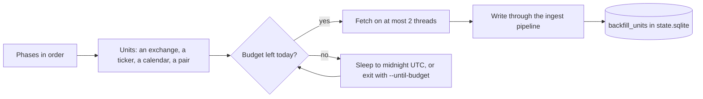

# Full backfill from EODHD

`stonks ingest backfill` fills the lake with everything an EODHD All-in-one plan offers that Stonks has tables for. It covers every exchange and every symbol, delisted ones too. That is far more than one day of API calls, so the backfill runs for days. It keeps its place in the state database, stays inside the daily call budget and starts again where it stopped.



## Before the first run

1. Back up `data/lake.duckdb` and `data/state.sqlite` (`stonks backup backup`).
2. Run `uv run stonks db init`. The backfill needs the lake's `instruments` table and state migration 061.
3. For a big lake, move bars to Parquet first: `uv run python -m stonks.store.bars_migrate --to parquet`.
4. Tell Stonks the plan. The shipped default is the free plan, which the backfill refuses. Set it in your own config or the environment, never in the shipped `config/default.toml`:

```toml
[ensure.plans]
eodhd = "all_in_one"
```

or `STONKS_EODHD_PLAN=all_in_one` in `.env`. The ensurer then also serves full history, bulk calls and intraday bars.

5. Stop `stonks serve`. DuckDB lets one process write the lake.

## Running it

```bash
uv run stonks ingest backfill run                    # runs for days, sleeps through each reset
uv run stonks ingest backfill run --until-budget     # exits when today's budget is spent
uv run stonks ingest backfill run --phases daily,actions --exchanges US,LSE
uv run stonks ingest backfill run --max-calls 5000   # a short trial
uv run stonks ingest backfill status [--json]
uv run stonks ingest backfill retry [--phases daily] # failed units get new attempts
```

Use `--until-budget` when a scheduler starts the run each day. Without it the process sleeps until 10 minutes after midnight UTC and goes on. Start a long run hidden and at low priority, for example on Windows:

```powershell
Start-Process -WindowStyle Hidden -FilePath uv -ArgumentList "run","stonks","ingest","backfill","run" -PassThru |
  ForEach-Object { $_.PriorityClass = "BelowNormal" }
```

`--exchanges` limits ticker phases to those exchange codes. Market-wide phases (calendars, macro) still run.

## Phases

Phases run in this order. Each is one module in `src/stonks/ingest/backfill/phases/`, so a new phase is one new module.

| Phase | Units | What it stores | Calls per unit |
|---|---|---|---|
| `symbols` | each exchange | `instruments`: asset class, equity kind, ISIN, delisted flag | 2 |
| `daily` | each instrument | full daily history in `bars` | 1 |
| `daily_topup` | each exchange and weekday | recent days by one bulk call, for tickers fetched before that day | 100 |
| `actions` | each equity | `dividends`, `stock_splits` | 2 |
| `fundamentals` | each common stock, ETF and fund | profile, analysts, holders, officers, shares outstanding, ESG, statements with versions (stocks), fund holdings (ETFs, funds), market cap (active stocks), insider trades (only on `insider_exchanges`) | 10 to 30 |
| `calendars` | earnings, dividends, economic | the three calendars from `calendar_start`, a month a step | about 1 to 6 a month |
| `macro` | each country and indicator | `macro_indicators` | 10 |
| `fx` | each six-letter pair on FOREX | `fx_rates` | 1 |
| `news` | each active stock and ETF | `news`, `news_sentiment` | 10 |
| `intraday_1h`, `intraday_5m`, `intraday_1m` | each common stock and ETF on `intraday_exchanges` | `bars` at that interval, a request window a step | 5 a step |

Within a phase, stocks run first, then ETFs, then funds, and active names before delisted ones. Forex pairs and money market rates are not instruments (`skip_exchanges`). One `/fundamentals` call fills the profile, the statements and the holdings together, so a stock never pays for it twice.

## Budget

Costs are EODHD's, measured on an All-in-one account:

| Endpoint | Calls |
|---|---|
| `/eod`, `/div`, `/splits`, symbol lists, calendars, economic events | 1 |
| `/intraday`, `/news`, `/sentiments` | 5 |
| `/fundamentals`, `/historical-market-cap`, `/insider-transactions`, `/macro-indicator` | 10 |
| `/eod-bulk-last-day` | 100 |
| `/user` | 0 |

Before each request the budget:

- paces requests to `requests_per_minute` (900, EODHD allows 1000),
- reads the account's count from `/user` at the start and every 10 minutes, so other processes on the same key count too,
- refuses a request that would pass `daily_budget` (95000) or the plan's own limit.

A refused request never leaves. The unit stays as it was and the next run picks it up. An HTTP 402 (allowance used) stops the day the same way. An HTTP 429 waits as long as `Retry-After` says. The day starts again at midnight UTC, when EODHD resets its counter.

## Failures

A unit that fails is tried again later, waiting 30 minutes and then twice as long each time. After 4 attempts it is marked failed. `retry` gives failed units new attempts. A ticker the vendor does not know (HTTP 404) is done with nothing stored and never asked again. Every write goes through the ingest pipeline, so bars get the usual quality checks and quarantine, and each batch has an `ingest_runs` row.

## Status

`status` reads only the state database. Per phase it shows units done, failed, waiting to retry and left, the calls spent, and the calls the rest should take at the average cost of the done units. It also shows today's calls and the days left at the daily budget.

## Settings

Under `[ingest.backfill]`, all optional:

| Key | Default | Meaning |
|---|---|---|
| `daily_budget` | 95000 | calls a UTC day may reach |
| `requests_per_minute` | 900 | request pace |
| `network_threads` | 2 | requests in flight, at most 2 |
| `max_attempts` | 4 | tries before a unit fails |
| `retry_backoff_minutes` | 30 | first wait before a retry |
| `usage_check_seconds` | 600 | how often `/user` is read |
| `reset_margin_minutes` | 10 | wait after midnight UTC |
| `duckdb_memory_limit`, `duckdb_threads` | `1GB`, 2 | DuckDB limits during the run |
| `skip_exchanges` | `FOREX`, `MONEY` | exchanges whose symbols are not instruments |
| `extra_exchanges` | none | codes to list besides the exchange list |
| `symbols_relist_days` | 7 | how often symbol lists are read again |
| `topup_days` | 10 | how far the bulk top-up looks back |
| `market_cap_delisted` | false | market cap for delisted stocks too |
| `insider_exchanges` | none | exchanges whose stocks get insider trades. Off because EODHD answered empty lists for AAPL on 2026-10-12. `stonks ingest edgar` has US insider trades |
| `calendar_start` | 2000-01-01 | first day of the calendars |
| `macro_countries`, `macro_indicators` | all | which macro series |
| `news_limit` | 1000 | articles per news request |
| `intraday_exchanges` | `US` | exchanges with intraday bars |
| `intraday_delisted` | false | intraday bars for delisted names too |
| `intraday_start` | 1h and 5m 2020-10-01, 1m 2004-01-01 | first day per interval |
| `intraday_window_days` | 1h 7200, 5m 600, 1m 120 | days per intraday request |

## Tables

State migration 061 adds `backfill_units` (one row per unit with status, attempts, calls, rows, cursor and last error), `backfill_phases` (when each phase last listed its units) and `backfill_calls` (calls per UTC day and the vendor's own count).
